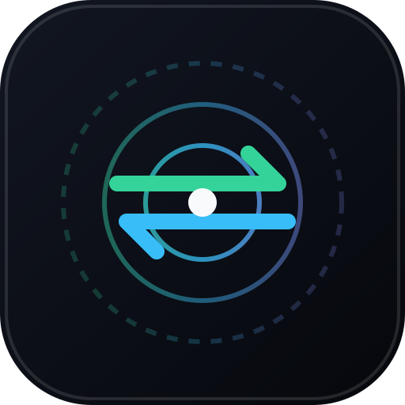

# AirBridge

<p align="center">
  <a href="https://airbridge.fyi/">
    
  </a>
</p>

<h3 align="center">AirBridge</h3>

<p align="center">
  <strong>Fast, Zero-Trust Encrypted File Transfer & Universal Clipboard Sync between Android, macOS, Windows, and Linux.</strong>
</p>

<p align="center">
  <a href="https://airbridge.fyi/"><strong>🌐 Official Website: airbridge.fyi</strong></a>
</p>

<p align="center">
  <a href="https://github.com/DigantaDey/AirBridge/actions/workflows/ci.yml"></a>
  <a href="https://github.com/DigantaDey/AirBridge/releases/latest"></a>
  <a href="LICENSE"></a>
  <a href="https://airbridge.fyi/"></a>
</p>

---

## Overview

**AirBridge** bridges the gap between Apple's ecosystem and Android. It delivers an AirDrop-like experience over your local Wi-Fi network without relying on cloud accounts, third-party servers, cables, or media-compressing chat apps.

With **End-to-End Encryption (E2EE)** powered by ECDH P-256 key exchange and AES-256-GCM chunk encryption, your files and clipboard content stay strictly private. AirBridge streams encrypted data directly between devices on your local area network (LAN), ensuring zero bandwidth limits, zero per-file size caps, and maximum local transfer speeds.

Whether you are dropping 50 GB video files or syncing clipboard snippets between your Mac and Android phone, AirBridge provides a unified, edge-to-edge native-web UI that behaves seamlessly across mobile, tablet, and desktop form factors.

---

## 🚀 Quick Install

Installing AirBridge requires **no paid developer accounts, app store logins, or cloud subscriptions**.

### macOS & Linux
```bash
curl -fsSL https://raw.githubusercontent.com/DigantaDey/AirBridge/main/install.sh | bash
```
> *On macOS, this creates `AirBridge.app` in `~/Applications` and places the executable in `~/.local/bin`.*

### Windows (PowerShell)
```powershell
powershell -ExecutionPolicy Bypass -Command "iwr https://raw.githubusercontent.com/DigantaDey/AirBridge/main/install.ps1 -UseBasicParsing | iex"
```

### Android
Download and install `AirBridge.apk` from the [Latest Release](https://github.com/DigantaDey/AirBridge/releases/latest).

---

## ✨ Features

### 📁 High-Speed Direct-to-Disk File Transfers
* **Zero File-Size Caps**: Stream multi-gigabyte files directly to disk without loading entire payloads into system RAM.
* **Resume Interrupted Transfers**: Append-only fixed-width resume journal (`.part` files) saves checkpoint batches, allowing dropped transfers to resume seamlessly from the last verified chunk.
* **SHA-256 Pre-Save Verification**: Every file is hashed with SHA-256 as it streams. The receiving device compares the computed hash against the declared hash **before** saving or publishing the file, preventing corrupted files from reaching your Downloads folder.
* **Batch Operations**: Send up to 100 mixed-type files per transfer session. Image transfers automatically generate WebP previews for immediate inspection.

### 📋 Background Universal Clipboard Sync
* **Bidirectional Syncing**: Copy text or images on your Mac, Windows, or Linux desktop, and instantly paste them on Android (and vice versa).
* **Headless Background Peer**: Desktop daemons maintain encrypted ECDH sessions in the background so clipboard syncing works even when browser tabs are closed.
* **Android Foreground Service**: Keeps encrypted WebCrypto sessions alive when the screen is off or when switching between Android apps.
* **Accessibility-Assisted Capture**: Optional, explicit opt-in Accessibility Service (`ClipboardAccessibilityService`) for enhanced background copy capture on Android 10+.

### 🔒 Zero-Trust End-to-End Encryption (E2EE)
* **Ephemeral ECDH P-256 Key Exchange**: Devices generate fresh keypairs per session to establish shared secrets.
* **AES-256-GCM Payload Encryption**: Control messages and 256 KiB binary file frames are encrypted on the sender before leaving the device and decrypted only after consent on the receiver.
* **6-Digit Verification Codes**: SAS (Short Authentication String) derivation lets users visually verify key integrity and prevent man-in-the-middle attacks.

### 📱 Adaptive Edge-to-Edge Native UI
* **Dynamic Safe-Area Handling**: Automatically calculates status bar, display cutout, and navigation bar insets, ensuring zero overlap with device status bars.
* **No Sideways Panning / Webpage Bounce**: Touch-action constraints (`pan-y`) and native overscroll mode (`OVER_SCROLL_NEVER`) eliminate horizontal page sliding for a 100% native app feel.
* **Light & Dark Studio Themes**: Automatically matches OS appearance settings with responsive layouts for phones, foldables, tablets, and desktop displays.

---

## 📊 Feature Comparison

| Feature / Capability | **AirBridge** | **Apple AirDrop** | **LocalSend** | **KDE Connect / NearDrop** | **PairDrop / Snapdrop** | **Quick Share** |
| :--- | :---: | :---: | :---: | :---: | :---: | :---: |
| **Android <-> macOS Support** | **Full (Native APK + macOS App)** | ❌ Apple Only | ⚠️ Separate UI Apps | ⚠️ Partial / Unofficial | 🌐 Browser Only | ❌ Windows/Android Only |
| **End-to-End Encryption (E2EE)** | **ECDH P-256 + AES-256-GCM** | 🔒 Proprietary | 🔒 TLS (P2P) | 🔒 TLS | 🔒 WebRTC / TLS | 🔒 Proprietary |
| **Universal Background Clipboard** | **Auto-Sync (Background Daemon + Service)** | ⚠️ Apple Devices Only | ❌ Manual Send | ⚠️ Requires Config | ❌ Manual | ❌ No |
| **Direct-to-Disk Chunked Streaming** | **Yes (`.part` Resume Journal)** | ⚠️ Memory Bounded | ⚠️ In-Memory Buffering | ⚠️ Memory Bounded | ❌ In-Memory Assembly | ⚠️ Variable |
| **SHA-256 Pre-Save Verification** | **Yes (Verified before rename)** | ❌ No | ❌ Post-Transfer | ❌ No | ❌ No | ❌ No |
| **No Cloud / 100% Offline LAN** | **Yes** | ⚠️ Needs Apple ID | **Yes** | **Yes** | ⚠️ Needs WebRTC STUN | ⚠️ Needs Google Acc |
| **CLI / Daemon Execution Mode** | **Yes (`npx airbridge` / Binary)** | ❌ No | ❌ No | ⚠️ Partial | ❌ No | ❌ No |

---

## 🛠️ Architecture & Technical Specs

AirBridge operates over a dual-layer network pipeline:

```
┌─────────────────┐       WebSocket (/ws) / WebRTC DataChannel      ┌─────────────────┐
│  Android App /  │ ═══════════════════════════════════════════════ │   macOS / PC    │
│  Browser Peer   │   ECDH P-256 Key Exchange + AES-256-GCM Payload │  Daemon / Host  │
└─────────────────┘                                                 └─────────────────┘
```

1. **Signaling & Relay**: WebSockets at `/ws` carry JSON control messages and binary payload frames (`0x01` encrypted chunk, `0x02` routed relay frame). WebRTC DataChannels are established whenever P2P ICE candidate gathering succeeds.
2. **Loopback Relay Protocol**: The Android APK runs a loopback relay (`http://127.0.0.1:<port>`) to serve the UI within a secure WebCrypto context without requiring custom CA certificate installation.
3. **Chunked Pipeline Tuning**:
   - **Chunk Size**: 256 KiB default (supports 16 KiB to 1 MiB bounds).
   - **Pipelining**: Up to 8 concurrent reads and AES-GCM encryption buffers in flight ahead of socket writes.
   - **Flow Control**: Backpressure applied above 4 MiB buffered socket data and released at 1 MiB.
   - **ACK Windows**: Receiver ACKs every 32 contiguous chunks stored on disk.

---

## 🔧 Configuration & Environment Variables

AirBridge daemons and CLI sessions can be customized via environment flags:

| Variable | Default | Description |
| :--- | :--- | :--- |
| `PORT` | `3000` | Port for the AirBridge HTTP/HTTPS signaling server |
| `AIRBRIDGE_DOWNLOAD_DIR` | `~/Downloads/AirBridge` | Destination folder for received files |
| `AIRBRIDGE_HTTPS` | `1` | Enforces TLS/HTTPS (set to `0` behind reverse proxies) |
| `AIRBRIDGE_TLS_CERT` / `AIRBRIDGE_TLS_KEY` | `null` | Path to custom PEM certificate and private key |
| `AIRBRIDGE_BACKGROUND_CLIPBOARD` | `1` | Enables/disables the headless encrypted background clipboard peer |

### Command Line Interface (CLI)

```bash
# Start background daemon with custom download directory
npx airbridge daemon --dir ~/Inbox --reveal

# One-shot terminal file send (generates pairing QR in terminal)
npx airbridge send ./Presentation.pdf ./Archive.zip
```

---

## 💻 Local Development & Testing

AirBridge is built with TypeScript, React, Vite, Express, and Kotlin.

```bash
# Clone repository
git clone https://github.com/DigantaDey/AirBridge.git
cd AirBridge

# Install dependencies
npm ci

# Start development server with Vite hot reloading
npm run dev

# Run full unit test suite (Vitest + JSDOM)
npm test

# Run TypeScript typechecking
npm run typecheck

# Build client and server bundles
npm run build
```

---

## 📄 License

This project is licensed under the **AirBridge Fair-Use & Non-Commercial License**.
- **Individual / Personal Use**: Free for personal, individual non-commercial use on personal devices.
- **Commercial / Enterprise / Organizational Use**: Any commercial, corporate, enterprise, or monetized usage requires explicit prior written consent from the author ([Diganta Dey](https://github.com/DigantaDey)).

See [LICENSE](LICENSE) for full legal terms.

<p align="center">
  Developed with ❤️ by <a href="https://github.com/DigantaDey">Diganta Dey</a> • <a href="https://airbridge.fyi/"><strong>airbridge.fyi</strong></a>
</p>
