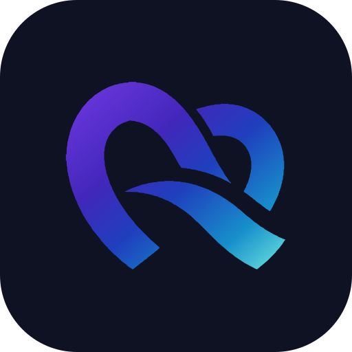
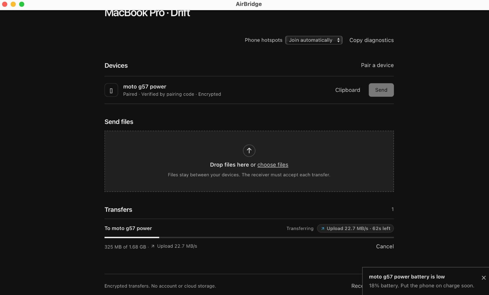
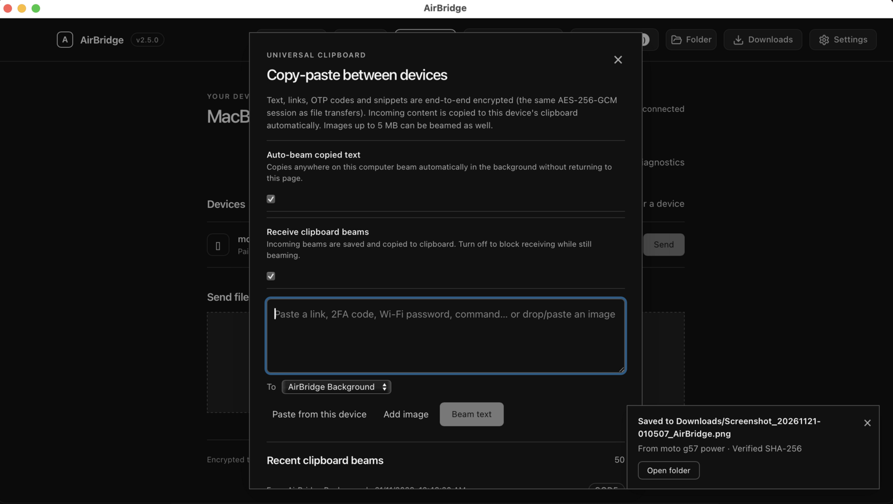
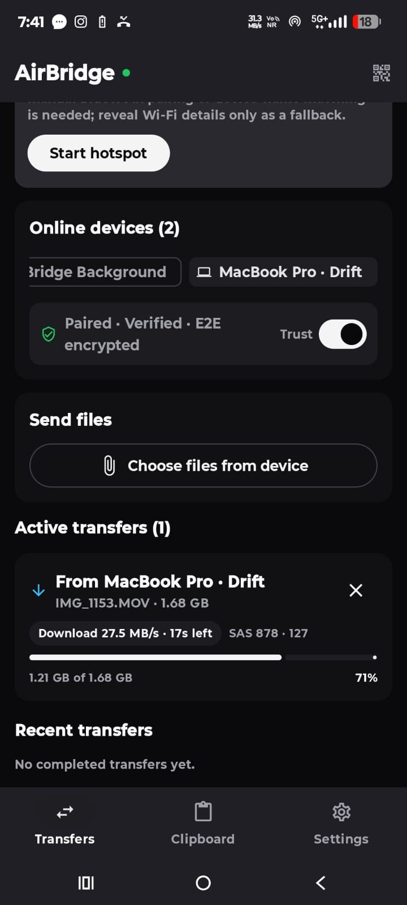
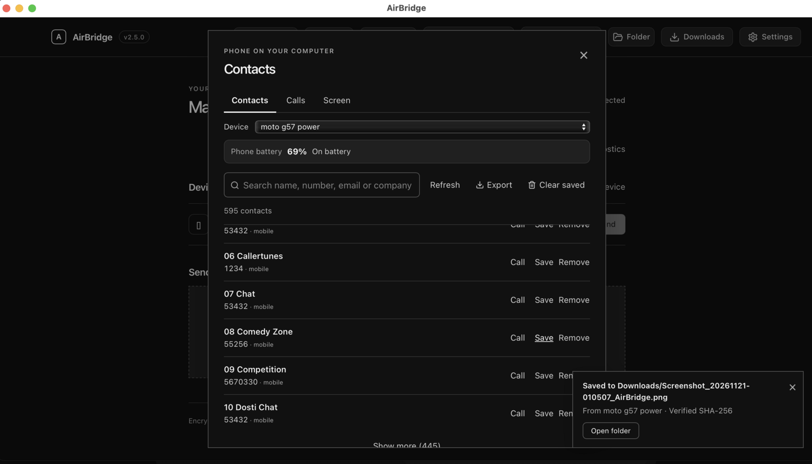

<p align="center">
  <a href="https://airbridge.fyi/">
    
  </a>
</p>

<h1 align="center">AirBridge</h1>

<h3 align="center">Android ↔ Mac, Windows &amp; Linux. Privately.</h3>

<p align="center">
  <strong>A source-available AirDrop alternative for Android and computers.</strong><br>
  Transfer files, sync your clipboard, share your Android screen, and connect your phone to your computer —<br>
  end-to-end encrypted, with no account and no cloud storage.
</p>

<p align="center">
  <a href="https://airbridge.fyi/"><strong>🌐 airbridge.fyi</strong></a> ·
  <a href="https://github.com/DigantaDey/AirBridge/releases/latest">⬇️ Latest release</a> ·
  <a href="docs/pairing-and-connectivity.md">📄 Docs</a> ·
  <a href="SECURITY.md">🔐 Security model</a>
</p>

<p align="center">
  <a href="https://github.com/DigantaDey/AirBridge/actions/workflows/ci.yml"></a>
  <a href="https://github.com/DigantaDey/AirBridge/releases/latest"></a>
  
  
  
  <a href="LICENSE"></a>
  <a href="https://airbridge.fyi/"></a>
</p>

---

## Download

Download builds from the [latest GitHub release](https://github.com/DigantaDey/AirBridge/releases/latest). Personal, non-commercial use is free. You do not need an account.

| Platform | Get it | Notes |
| :--- | :--- | :--- |
| 🍎 **macOS** (Apple silicon / Intel) | [`AirBridge-macOS-arm64.zip`](https://github.com/DigantaDey/AirBridge/releases/latest/download/AirBridge-macOS-arm64.zip) · [`AirBridge-macOS-x64.zip`](https://github.com/DigantaDey/AirBridge/releases/latest/download/AirBridge-macOS-x64.zip) | Ad-hoc signed menu-bar app. One-line installer below. |
| 🪟 **Windows** (x64 / ARM64) | [`AirBridge-windows-x64.exe`](https://github.com/DigantaDey/AirBridge/releases/latest/download/AirBridge-windows-x64.exe) · [`AirBridge-windows-arm64.exe`](https://github.com/DigantaDey/AirBridge/releases/latest/download/AirBridge-windows-arm64.exe) | Portable EXE, no installer and no admin rights. |
| 🐧 **Linux** (x64 / arm64, glibc / musl) | [`AirBridge-linux-x64`](https://github.com/DigantaDey/AirBridge/releases/latest/download/AirBridge-linux-x64) · [`AirBridge-linux-arm64`](https://github.com/DigantaDey/AirBridge/releases/latest/download/AirBridge-linux-arm64) · [`-musl` variants](https://github.com/DigantaDey/AirBridge/releases/latest) | Static binaries, per-user install, XDG launcher entry. |
| 📱 **Android** (8.0 / API 26+) | [`AirBridge-android-debug.apk`](https://github.com/DigantaDey/AirBridge/releases/latest/download/AirBridge-android-debug.apk) | Installable testing/sideload build. Play upload path: [docs/PLAY_STORE_RELEASE.md](docs/PLAY_STORE_RELEASE.md). |
| ⌨️ **CLI / any OS with Node 20+** | `npx airbridge` or [source](#build-from-source) | Daemon, relay, one-shot sends, headless receivers. |
| ✅ **Verify anything** | [`SHA256SUMS.txt`](https://github.com/DigantaDey/AirBridge/releases/latest/download/SHA256SUMS.txt) | Plus keyless Sigstore attestations — `gh attestation verify <file> -R DigantaDey/AirBridge`. |

**macOS & Linux**

```bash
curl -fsSL https://raw.githubusercontent.com/DigantaDey/AirBridge/main/install.sh | bash
```

**Windows (PowerShell)**

```powershell
powershell -ExecutionPolicy Bypass -Command "iwr https://raw.githubusercontent.com/DigantaDey/AirBridge/main/install.ps1 -UseBasicParsing | iex"
```

Both installers verify the download against the release checksums before running it. `--autostart` / `-Autostart` registers a per-user login item. Building from source is covered under [development](#development).

> **Before you install:** the macOS build is ad-hoc signed (not notarised) and the Windows EXE is unsigned, because vendor certificates are paid subscriptions this project does not buy. Integrity comes from `SHA256SUMS.txt`, Sigstore attestations, and the desktop self-updater, which refuses an artefact that fails verification. A browser-downloaded macOS app needs one right-click → *Open*; the `curl` installer avoids the quarantine flag entirely.

---

## See it running

<table>
  <tr>
    <td width="50%"><br><sub><strong>Android ↔ desktop file transfer.</strong> A 1.68 GB video mid-send: live speed, remaining time, cancel, and SHA-256 verification before the file is saved.</sub></td>
    <td width="50%"><br><sub><strong>Universal clipboard.</strong> Text, links and 2FA codes beam between devices; on macOS, copied photos arrive as photos instead of binary noise.</sub></td>
  </tr>
  <tr>
    <td><br><sub><strong>The phone side.</strong> 1.68 GB arriving at 27.5 MB/s, with the verified peer fingerprint shown under the progress bar.</sub></td>
    <td><br><sub><strong>Phone on your computer.</strong> Contacts, a dialer, incoming-call controls, phone battery — and opt-in Mac call audio.</sub></td>
  </tr>
</table>

More screens and per-task walkthroughs: **[airbridge.fyi/guides.html](https://airbridge.fyi/guides.html)**.

---

## What AirBridge is

AirBridge connects **Android** with **macOS, Windows and Linux**. Send files, share a clipboard, view your phone’s screen, and use contacts and calls from your computer. Content is encrypted end to end. The source is public under a Fair-Use & Non-Commercial licence; commercial or organisational use needs written consent.

- **Who it is for:** people who keep an Android phone and a Mac, Windows PC or Linux desktop, and do not want a cloud account in the middle of every file.
- **What problem it solves:** Android has no AirDrop, and most cross-platform tools stop at file transfer. AirBridge puts files, clipboard, screen, contacts and calls in one verified session.
- **Why it is different:** the pairing code is never transmitted (SPAKE2, RFC 9382), payloads are AES-256-GCM encrypted, recipients verify SHA-256 before a file is published, no Accessibility or notification-listener permissions are used, and there is no AirBridge server that stores your content.

### Core capabilities

| | Capability |
| :--- | :--- |
| 🔐 | **End-to-end encrypted** — SPAKE2 pairing, ECDH P-256 + HKDF session keys, AES-256-GCM for every chunk, clipboard item, call frame and screen frame. |
| 📁 | **Direct device-to-device transfer** — WebSocket binary pipeline on your LAN, with WebRTC data channels when ICE succeeds. No upload step. |
| ♻️ | **Resumable file transfers** — direct-to-disk `.part` journals, TCP backpressure and identity-matched resume inside a running session. |
| ✅ | **SHA-256 verified before saving** — a file reaches your Downloads folder only when the digest matches. |
| 📋 | **Universal clipboard** — bidirectional text; photos from macOS to Android; SHA-256 echo suppression. |
| 🖥️ | **Android screen sharing** — consent-based H.264 (`MediaCodec` → WebCodecs `avcC`) with PLI keyframe recovery. |
| 👤 | **Phone integration** — search contacts, dial and answer calls, see who is calling, optional two-way Mac call audio. |
| 📶 | **QR / 6-character pairing** — plus phone-hotspot handoff and a self-hostable relay for networks with no direct path. |
| 🧩 | **macOS, Windows and Linux companions** — plus a CLI, a headless daemon and a relay. |
| ☁️ | **No account, no cloud storage, no analytics SDK** in the Android app. |
| 🧾 | **Source available** — the server, clients, Android app, macOS shell, installers and release workflows are all in this repository. |

### Why AirBridge

- **Android to Mac, Android to Windows, Android to Linux** — one companion app per desktop, one phone app, one pairing.
- **A real AirDrop alternative for Android** where Apple's tools simply refuse to participate, without pretending to speak Apple protocols.
- **Private file transfer** that never parks your files in an account you cannot audit.
- **Cross-platform device connectivity** including screen sharing and clipboard sync — not just a send button.
- **Source-available and self-hostable** — read the protocol, run your own relay, keep your data on your devices.

---

## Supported platforms

| Platform | Support | Notes |
| :--- | :--- | :--- |
| Android 8.0+ (API 26) | Native Jetpack Compose app | Background foreground-service engine, no Accessibility service. |
| macOS (Apple silicon, Intel) | Menu-bar app + service | Ad-hoc signed; Launchpad/Finder install into `~/Applications`. |
| Windows 10/11 (x64, ARM64) | Portable executable | No installer, no admin rights, per-user PATH. |
| Linux (x64, arm64; glibc, musl) | Static binary + XDG launcher | No root; optional systemd **user** service for autostart. |
| Any OS with Node.js 20+ | CLI, daemon, relay | `npx airbridge`, browser UI on port 3000. |

Not supported: iOS/iPadOS (there is no iOS client), and remote control of the phone from the desktop.

---

## Privacy and security

- **Pairing** — the six-character code is proven with **SPAKE2 (RFC 9382)**; it is never sent, not even hashed, and guesses are rate-limited.
- **Sessions** — ephemeral **ECDH P-256** with **HKDF** derivation, per-chunk **AES-256-GCM**, and a six-digit **SAS** you can compare on both screens to rule out a man-in-the-middle.
- **Identity** — pinned local TLS CA on first use; a changed identity requires forget-and-repair, never a silent downgrade to plaintext.
- **Host boundary** — writing the desktop clipboard, saving into the receive folder, revealing files and opening folders are loopback-only.
- **Permissions** — no Accessibility Service, no notification listener, no `READ_CALL_LOG`, Android backup disabled. Contacts, calls, microphone and screen capture are off until you switch each one on.
- **Diagnostics** — bounded, scrubbed locally, redacting paths, usernames, IP/MAC addresses, SSIDs, codes, tokens and keys; shared only when you click a share action.

What an observer on the network **can** still see — device names and public keys before pairing, and connection metadata such as addresses and timing — is documented in [SECURITY.md](SECURITY.md) and [the privacy guide](https://airbridge.fyi/private-file-transfer.html). No third-party audit is claimed, and no absolute security language is used anywhere in this project — the [SECURITY.md](SECURITY.md) notes name the residual risks instead.

---

## Quick start

1. **Install the desktop companion** with the command above (or a release artefact for your platform).
2. **Install the Android app**, open it, and scan the QR code shown on the computer — or type the six-character code.
3. **Compare the six-digit verification code** on both devices the first time. After that the peer is trusted and pinned.
4. **Send something.** Drop files on the desktop window or use *Share → AirBridge* on the phone; accept the offer on the other side; the file appears in `Downloads/AirBridge` after its SHA-256 digest matches.
5. **Optional:** copy text on either device (clipboard sync), open **Screen** to view the phone, or open **Calls** to dial from the desktop.

Guides for each workflow: [Android to Mac](https://airbridge.fyi/android-to-mac-file-transfer.html) · [Android to Windows](https://airbridge.fyi/android-to-windows-file-transfer.html) · [Android to Linux](https://airbridge.fyi/android-to-linux-file-transfer.html) · [AirDrop alternative](https://airbridge.fyi/android-airdrop-alternative.html) · [clipboard sync](https://airbridge.fyi/android-clipboard-sync.html) · [screen sharing](https://airbridge.fyi/android-screen-sharing.html) · [private transfer](https://airbridge.fyi/private-file-transfer.html).

---

## Features in detail

### 📁 High-speed direct-to-disk file transfers
* **Native direct-to-disk streaming**: Android and the desktop daemon stream multi-gigabyte files without file-sized RAM buffers. Browser-only receivers use the File System Access API when available; the memory-only fallback is capped at 128 MiB across active receives and retained download payloads — use the native app or a disk-backed receive folder for larger files.
* **Resume interrupted connections**: append-only journals checkpoint private `.part` files. Both engines can resume a network interruption within a running session, reusing consent only for the same encrypted peer key and manifest. A force-stop/process death or changed identity requires a new send; final SHA-256 is always checked.
* **SHA-256 pre-save verification**: every file is hashed as it streams; the receiver compares the computed hash against the declared one **before** saving or publishing, so corruption never reaches your Downloads folder.
* **Batch operations**: up to 100 mixed-type files per transfer session. Image transfers generate WebP previews for immediate inspection.

### 📋 Background universal clipboard sync
* **Bidirectional text and photos**: text and images sync between paired devices over end-to-end encrypted sessions. On macOS, native `NSPasteboard` inspection captures copied photos cleanly with SHA-256 echo suppression instead of sending binary noise; incoming images can be placed on both Android's and macOS's system clipboard. Windows uses the built-in PowerShell clipboard cmdlets and Linux uses `wl-clipboard`/`xclip`/`xsel`; both of those bridges carry text.
* **Headless background peer**: desktop daemons keep encrypted ECDH sessions open so clipboard syncing works with the browser tab closed.
* **Native Android foreground service**: owns Kotlin encryption, WebSockets, URI sources, disk writes, incoming clipboard delivery and transfer notifications independently of the Activity/WebView. Active transfers hold CPU/Wi-Fi performance locks; no file payloads cross the JavaScript bridge.
* **Honest clipboard fallback**: Android 10+ restricts background clipboard reads. AirBridge does not use Accessibility Services; use **Share → AirBridge**, **Process text → AirBridge**, the Quick Settings tile, or **Paste** in AirBridge to send from another app reliably.

### 🔒 Zero-trust end-to-end encryption (E2EE)
* **Ephemeral ECDH P-256 key exchange**: devices generate fresh keypairs per session.
* **AES-256-GCM payload encryption**: control messages and 1 MiB binary file frames (default; 16 KiB–1 MiB supported) are encrypted on the sender and decrypted only after consent on the receiver.
* **Six-digit verification codes**: SAS derivation lets you verify key integrity out of band and detect a man-in-the-middle.

### 🛰️ Pairing and connectivity anywhere
* **Secure code exchange (SPAKE2, RFC 9382)**: the pairing code is never transmitted, not even hashed; attempts are rate-limited. The code-holding computer vouches for each device, so paired devices show **Verified** without comparing digits again.
* **Relay fallback**: when no direct path exists (different networks, client isolation, CGNAT), the phone connects through a self-hostable relay (`airbridge relay`). TLS stays end to end and pinned, so the relay only sees ciphertext, and the session returns to a direct path automatically.
* **Hotspot handoff**: tap **Use this phone's hotspot** and the computer joins the phone's private hotspot after you approve it. Credentials are sealed to the paired computer and travel over the connection, or over **Bluetooth LE** when there is no connection at all (macOS app).
* **Crash reports and staged rollouts**: crashes are recorded locally, scrubbed of personal data, and sent only when you click. Updates reach 10% → 50% → 100% of computers over three days, and a bad release can be paused.

See [Pairing and connectivity](docs/pairing-and-connectivity.md) for the protocols, the threat model and the manual test plan.

### 📞 Your phone on your computer
* **Contacts**: search and browse the phone's contacts from the computer, call or save any of them (vCard), and send contacts in either direction. Contacts synced to the desktop stay saved locally across modal closes and reloads until you remove them or the paired device disconnects. Received contacts open Android's own editor, so AirBridge never needs permission to change your address book.
* **Calls**: see who's calling, answer, decline or hang up from the computer, or place calls with the dialer. When you opt into **Use Mac Audio** (microphone permission on Android and Mac), AirBridge bridges two-way end-to-end encrypted 16 kHz call audio between your computer and Android (speakerphone-assisted on standard Android builds); otherwise audio stays on your phone or headset. Hanging up needs Android 9 or later.
* **Screen casting**: view the phone's screen live on the computer through a low-latency H.264 stream. Computers can also share a screen or window with each other through the browser's picker. Video and any permitted app audio are end-to-end encrypted and adapt to the link. App audio is off by default and must be enabled for each Android session; Android and the source app control availability, so protected/opted-out content is never bypassed. Every session must be approved on the device being shared and can be stopped from either side.
* **Everywhere on the desktop**: Contacts, Calls and Screen buttons in the app's top bar, a **Phone** menu and menu-bar entries in the macOS app, and **Contacts / Calls / Screen Sharing** actions on the Linux app launcher (GNOME, KDE, …). The version is always visible: top bar, menu-bar menu, **About AirBridge**, and the launcher.
* **You stay in control**: each feature has its own switch and permission in the Android app (**Settings → Phone on your computer**). Only paired, verified devices can use them.

### 📱 Adaptive edge-to-edge native UI
* **Dynamic safe-area handling**: calculates status bar, display cutout and navigation bar insets so nothing overlaps the system UI.
* **No sideways panning or page bounce**: touch-action constraints (`pan-y`) and native overscroll mode (`OVER_SCROLL_NEVER`).
* **Light and dark themes** that follow the OS appearance setting, with layouts for phones, foldables, tablets and desktops.

---

## AirBridge compared with other tools

| Feature / capability | **AirBridge** | **Apple AirDrop** | **LocalSend** | **KDE Connect / NearDrop** | **PairDrop / Snapdrop** | **Quick Share** |
| :--- | :---: | :---: | :---: | :---: | :---: | :---: |
| **Android ↔ macOS support** | **Full (native APK + macOS app)** | ❌ Apple only | ⚠️ Separate UI apps | ⚠️ Partial / unofficial | 🌐 Browser only | ❌ Windows/Android only |
| **End-to-end encryption (E2EE)** | **ECDH P-256 + AES-256-GCM + SAS** | 🔒 Proprietary | 🔒 TLS (P2P) | 🔒 TLS | 🔒 WebRTC / TLS | 🔒 Proprietary |
| **Universal background clipboard** | **Daemon + native service; Android capture restrictions apply** | ⚠️ Apple devices only | ❌ Manual send | ⚠️ Requires config | ❌ Manual | ❌ No |
| **Direct-to-disk chunked streaming** | **Yes (`.part` resume journal)** | ⚠️ Memory bounded | ⚠️ In-memory buffering | ⚠️ Memory bounded | ❌ In-memory assembly | ⚠️ Variable |
| **SHA-256 pre-save verification** | **Yes (verified before rename)** | ❌ No | ❌ Post-transfer | ❌ No | ❌ No | ❌ No |
| **No cloud / offline LAN** | **Yes** | ⚠️ Needs Apple ID | **Yes** | **Yes** | ⚠️ Needs WebRTC STUN | ⚠️ Needs Google account |
| **Contacts, calls and screen from the computer** | **Yes (E2EE, per-feature consent)** | ⚠️ Apple devices only | ❌ No | ⚠️ Partial | ❌ No | ❌ No |
| **CLI / daemon execution mode** | **Yes (`npx airbridge` / binary)** | ❌ No | ❌ No | ⚠️ Partial | ❌ No | ❌ No |
| **iOS client** | ❌ No | ✅ Yes | ✅ Yes | ⚠️ Limited | ✅ Browser | ⚠️ Varies |

**Where another tool is the better choice:** LocalSend if you need a permissively licensed project or iOS in the mix; KDE Connect if you live in KDE Plasma and want notification mirroring and remote input; AirDroid if you need remote management over the internet; Quick Share if you only move files between Windows and Android and want zero setup; AirDrop if everything you own is Apple. AirBridge targets the mixed **Android + desktop** case with one verified session for files, clipboard, screen, contacts and calls. The full, deliberately unflattering comparison is at [airbridge.fyi/compare.html](https://airbridge.fyi/compare.html).

---

## Architecture and technical specs

AirBridge operates over a dual-layer network pipeline:

```
┌─────────────────┐       WebSocket (/ws) / WebRTC DataChannel      ┌─────────────────┐
│  Android App /  │ ═══════════════════════════════════════════════ │   macOS / PC    │
│  Browser Peer   │   ECDH P-256 Key Exchange + AES-256-GCM Payload │  Daemon / Host  │
└─────────────────┘                                                 └─────────────────┘
```

1. **Signaling and relay**: WebSockets at `/ws` carry JSON control messages and binary payload frames (`0x01` encrypted chunk, `0x02` routed relay frame). WebRTC data channels are established whenever P2P ICE candidate gathering succeeds.
2. **Native Android ownership**: the APK bundles its own UI; a metadata-only bridge attaches it to the service-owned Kotlin engine. File bytes go from ContentResolver streams to encrypted sockets, or from verified private staging to Downloads/AirBridge. A bounded loopback proxy serves desktop API requests only. Android pins the desktop's local TLS CA on first use, validates subsequent chains/hostnames, and never silently downgrades HTTPS to HTTP. Compare the E2EE verification code on first contact; explicit `http://` links remain available for intentionally plaintext servers.
3. **Chunked pipeline tuning**:
   - **Chunk size**: 1 MiB default (16 KiB to 1 MiB bounds).
   - **Pipelining**: browser senders pipeline up to 8 read/encrypt operations; Kotlin overlaps socket reads, ordered decryption/storage and a separate network writer using bounded queues. Neither inserts a fixed-rate sleep between chunks.
   - **Flow control**: browser socket watermarks are 8 MiB / 2 MiB; Kotlin's incoming queue is byte-bounded at 16 MiB and 128 items and the outgoing queue at 8 MiB and 256 items (one oversized clipboard envelope may be admitted alone). Socket buffers are requested before connecting so TCP window scaling can use the available device/kernel capacity.
   - **ACK windows**: 32 MiB window byte budget (32–128 in-flight chunks; 32 at 1 MiB), ACK every 2 MiB (2–16 chunks; 2 at 1 MiB) or 150 ms on progress; a 60-second no-progress stall is timed only while the sender is waiting. The sender waits for the receiver's SHA-256/publication confirmation before declaring success.
   - **Safety limits**: up to 100 files and 262,144 chunks in a manifest (256 GiB total at the default 1 MiB chunk size). These are allocation/validation limits, not a bandwidth cap. Frames/messages are bounded at 16 MiB; clipboard text at 256,000 characters and image data at about 5 MiB binary.

---

## Android background behavior

1. Update both the APK and desktop to the current release, pair using the desktop QR, and compare the six-digit verification code.
2. Keep **Settings → Background clipboard & connection** enabled for idle discovery and incoming clipboard. For long screen-off transfers, open **Settings → Background battery access → Open battery settings** and allow **Unrestricted / Don't optimize** for AirBridge; some OEMs also require allowing background activity/auto-start. Allow notifications to accept/decline offers without reopening the screen. An already-active transfer continues even if idle continuity is disabled.
3. Switching apps, Back, or a WebView renderer restart does not own/stop the native transfer. The foreground notification shows its state and speed. Android force-stop, the notification's Stop action, reboot, revoked URI access, or aggressive OEM battery management can still terminate the service; no app can promise to survive those actions. This release does not auto-start at boot.
4. **Android → desktop clipboard**: ordinary hidden clipboard reads may be blocked even with Accessibility enabled. Share text to AirBridge, or select text and choose AirBridge, for an explicit background send. Password-manager clips marked sensitive are excluded from automatic capture. **Desktop → Android** clipboard delivery is service-owned and does not need this screen open.
5. Verified incoming files appear in **Downloads/AirBridge** on Android 10+. Android 8/9 falls back to app-specific Downloads when public-storage permission is unavailable; uninstalling removes app-specific files.
6. If the desktop's pinned TLS identity changes, verify the desktop, choose **Forget computer**, and scan its new QR. A TLS error is not permission to downgrade the connection. Plaintext desktops require an explicit `http://host:port` invitation.

There is no configured kbit/s or KiB/s speed limiter. To diagnose a slow phone, compare the same large file in each direction, note **B/s versus bit/s**, test strong 5 GHz/6 GHz Wi-Fi with a wired desktop, and compare foreground versus screen-off behavior. Automated JVM/desktop tests do **not** establish real-phone throughput or OEM background behavior; see the [device validation checklist](docs/ANDROID_VALIDATION.md).

---

## Configuration and environment variables

AirBridge daemons and CLI sessions can be customized via environment flags:

| Variable | Default | Description |
| :--- | :--- | :--- |
| `PORT` | `3000` | Port for the AirBridge HTTP/HTTPS signaling server |
| `AIRBRIDGE_DOWNLOAD_DIR` | `~/Downloads/AirBridge` | Destination folder for received files |
| `AIRBRIDGE_HTTPS` | `1` | Enforces TLS/HTTPS (set to `0` behind reverse proxies) |
| `AIRBRIDGE_TLS_CERT` / `AIRBRIDGE_TLS_KEY` | `null` | Path to custom PEM certificate and private key |
| `AIRBRIDGE_BACKGROUND_CLIPBOARD` | `1` | Enables/disables the headless encrypted background clipboard peer |
| `AIRBRIDGE_AUTO_UPDATE` | `1` | Set `0` to disable the desktop self-updater (checks GitHub releases, verifies SHA-256, installs only on request) |
| `AIRBRIDGE_REVERSE_CONNECT` | `1` | Set `0` to stop the computer from dialling a phone that cannot reach it |
| `AIRBRIDGE_RELAY` | saved `--relay` value | `host:port` of an AirBridge relay for phones with no direct path (`off` disables it) |
| `AIRBRIDGE_HANDOFF` | `1` | Set `0` to disable hotspot handoff (also: **Phone hotspots → Never join** in the UI) |
| `AIRBRIDGE_CRASH_DSN` | unset | Sentry DSN for crash reports you choose to send (otherwise a prefilled GitHub issue opens). Also read from `~/.airbridge/crash-dsn` |

### Command line interface (CLI)

```bash
# Start a background daemon with a custom download directory
npx airbridge daemon --dir ~/Inbox --reveal

# One-shot terminal file send (generates a pairing QR in the terminal)
npx airbridge send ./Presentation.pdf ./Archive.zip

# Open a panel (contacts, calls, screen or settings); reuses a running AirBridge
AirBridge --open calls

# Run a relay on an always-on box, and point a computer at it
airbridge relay --listen 0.0.0.0:47391
airbridge --relay relay.example.com:47391
```

---

## Development

AirBridge is built with TypeScript, React, Vite, Express and Kotlin.

```bash
# Clone repository
git clone https://github.com/DigantaDey/AirBridge.git
cd AirBridge

# Install dependencies
npm ci

# Start the development server with Vite hot reloading
npm run dev

# Run the full unit test suite (Vitest + JSDOM)
npm test

# TypeScript typechecking
npm run typecheck

# JS/TS and shell linters
npm run lint

# Build client and server bundles
npm run build

# Regenerate the static guide pages in website/ after editing scripts/site-pages/
npm run website:pages

# Android: needs JDK 17, Gradle 8.14.3 and Android SDK 35 (Node deps above).
# The Play AAB additionally needs a private upload key — see docs/PLAY_STORE_RELEASE.md.
gradle -p android :engine:check :app:assembleDebug
gradle -p android :app:bundleRelease   # signed AAB; fails closed without upload-key config
npx tsx scripts/test-native-interop.ts # HTTP/TLS Kotlin ↔ Kotlin/TS, 128 MiB JVM
```

### Build from source

```bash
npm ci && npm run build:desktop   # current-platform binary in dist-bin/
```

### Documentation

| Document | What it covers |
| :--- | :--- |
| [docs/pairing-and-connectivity.md](docs/pairing-and-connectivity.md) | Pairing protocol, relay, hotspot handoff, threat model, manual test plan |
| [docs/desktop-runtime.md](docs/desktop-runtime.md) | Desktop runtime, self-updater, staged rollout and rollback |
| [docs/DISTRIBUTION.md](docs/DISTRIBUTION.md) | Release artefacts, signing strategy, checksums and attestations |
| [docs/ANDROID_VALIDATION.md](docs/ANDROID_VALIDATION.md) | Real-device validation checklist and OEM background notes |
| [docs/PLAY_STORE_RELEASE.md](docs/PLAY_STORE_RELEASE.md) | Play AAB release gate, permissions and data-safety answers |
| [docs/hotspot-pairing.md](docs/hotspot-pairing.md) | Hotspot credential handoff details |
| [SECURITY.md](SECURITY.md) | Trust boundaries, fixed issues and audit notes |
| [TEST_INFRA.md](TEST_INFRA.md) | Test infrastructure and tiers |

---

## Contributing

Contributions, bug reports and feature discussions are welcome — especially reports from real Android devices, because background behaviour varies by OEM.

- Read [CONTRIBUTING.md](CONTRIBUTING.md) for the setup, test and review expectations.
- By participating you agree to the [Code of Conduct](CODE_OF_CONDUCT.md).
- Found a security issue? Do **not** open a public issue; follow [SECURITY.md](SECURITY.md).
- Use the issue templates for bug reports, feature requests and device reports.

---

## License

This project is licensed under the **AirBridge Fair-Use & Non-Commercial License**.

- **Individual / personal use**: free for personal, individual non-commercial use on personal devices.
- **Commercial / enterprise / organizational use**: any commercial, corporate, enterprise or monetized usage requires explicit prior written consent from the author ([Diganta Dey](https://github.com/DigantaDey)).

The source is public and readable, but this is not an OSI-approved licence — see [LICENSE](LICENSE) for the full terms before relying on it at work.

<p align="center">
  Developed with ❤️ by <a href="https://github.com/DigantaDey">Diganta Dey</a> • <a href="https://airbridge.fyi/"><strong>airbridge.fyi</strong></a><br>
  <sub>AirDrop, Continuity and iPhone Mirroring are Apple trademarks. Android, Quick Share and Google Play are Google trademarks. AirBridge is an independent project, not affiliated with or endorsed by either company.</sub>
</p>
